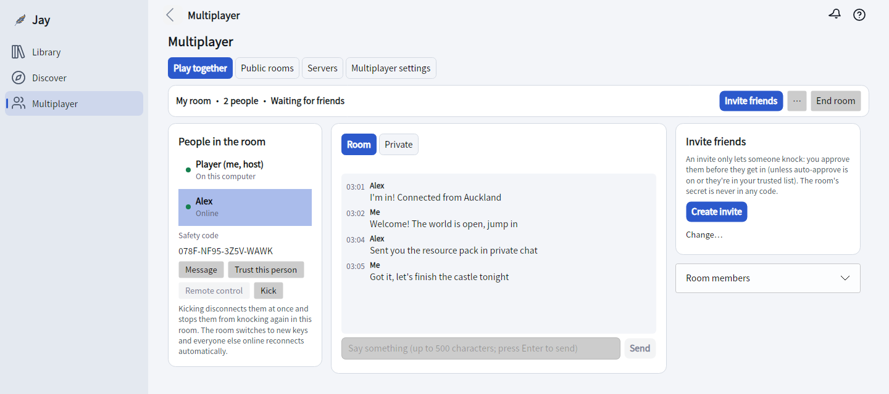
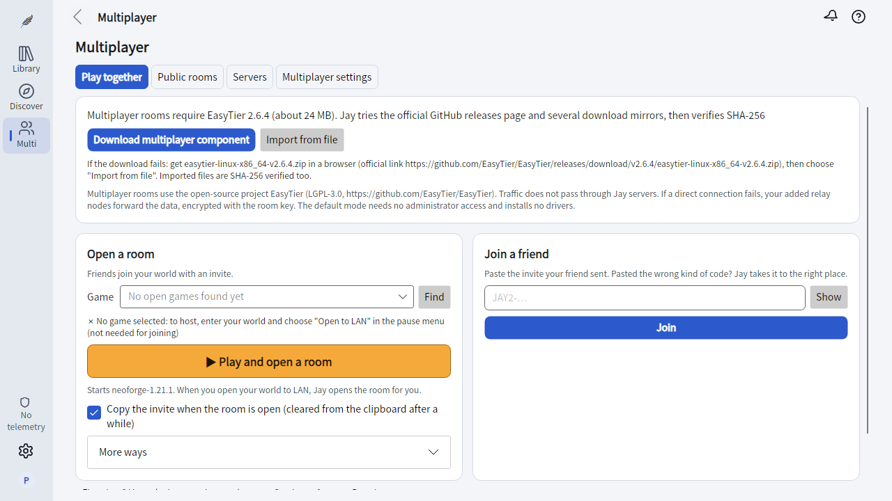
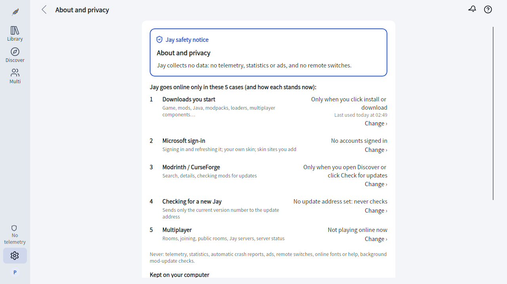
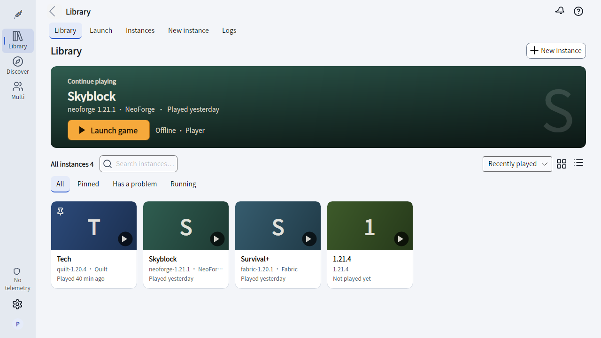

<div align="center">


# Jay

### A private place for you and your friends: play, chat, share. Minecraft launcher built in.

Play Minecraft or any LAN game together across borders, chat and send files end to end encrypted,<br>
help a friend with remote control, or borrow a friend's connection. Source available, no telemetry at all.

[](https://github.com/warriorleavestar/jay-launcher/releases/latest)
[](https://github.com/warriorleavestar/jay-launcher/actions/workflows/build.yml)
[](LICENSE)

[](https://github.com/warriorleavestar/jay-launcher/releases/latest/download/Jay-win-x64.zip)
[](https://github.com/warriorleavestar/jay-launcher/releases/latest/download/Jay-osx-arm64.tar.gz)
[](https://github.com/warriorleavestar/jay-launcher/releases/latest/download/Jay-linux-x64.tar.gz)

**English** · [简体中文](README.zh-Hans.md) · [Download](#download) · [Features](#features) · [Privacy](#privacy) · [FAQ](#faq) · [Contributing](CONTRIBUTING.md)



</div>

<br>

<table>
<tr>
<td width="50%" valign="top">

### 🌏 Your friends, one LAN

Share an invite, your friend "knocks", you let them in, and you are on the same virtual LAN wherever you live. Minecraft, other LAN games and LAN apps just work. Jay connects directly when it can and only relays when it has to.

</td>
<td width="50%" valign="top">

### 💬 Chat and share, end to end

Group chat for the room, private messages to one friend, and file transfer, all end-to-end encrypted with each person's own key. Relay nodes see nothing. Need a hand? Ask to remote-control a friend's screen, with their OK every time.

</td>
</tr>
<tr>
<td width="50%" valign="top">

### 🔒 Private by design

Invites are single-use and expire; leaked codes are useless. Nobody gets in without your approval, and kicking someone rotates the room key. No telemetry, no device ID, no remote switches, and no Jay server in the middle.

</td>
<td width="50%" valign="top">

### 🎮 A full Minecraft launcher

Fabric, Quilt, Forge, NeoForge and OptiFine in one click, Modrinth and CurseForge built in, modpack import and export, and crash analysis that tells you which mod to blame.

</td>
</tr>
</table>

> [!NOTE]
> Jay was called **Amber** until v0.7.0; accounts and settings carry over. Everyone in a multiplayer room needs v0.7.0 or newer.
> Features marked *experimental* pass the automated tests but have not been fully proven in real-world use. [Tell us](https://github.com/warriorleavestar/jay-launcher/issues/new/choose) when something breaks.

## Download

Grab the file for your computer from the [latest release](https://github.com/warriorleavestar/jay-launcher/releases/latest), unzip it and run. Nothing to install: .NET is included, and Jay finds or downloads the right Java for each game version.

| System | File | Status |
|---|---|---|
| **Windows 10+** x64 | [`Jay-win-x64.zip`](https://github.com/warriorleavestar/jay-launcher/releases/latest/download/Jay-win-x64.zip) | ✅ Stable |
| **macOS** Apple silicon | [`Jay-osx-arm64.tar.gz`](https://github.com/warriorleavestar/jay-launcher/releases/latest/download/Jay-osx-arm64.tar.gz) | ✅ Tested on a real Mac |
| **macOS** Intel | [`Jay-osx-x64.tar.gz`](https://github.com/warriorleavestar/jay-launcher/releases/latest/download/Jay-osx-x64.tar.gz) | 🧪 Experimental |
| **Linux** x64 | [`Jay-linux-x64.tar.gz`](https://github.com/warriorleavestar/jay-launcher/releases/latest/download/Jay-linux-x64.tar.gz) | 🧪 Experimental |
| **Linux** ARM64 | [`Jay-linux-arm64.tar.gz`](https://github.com/warriorleavestar/jay-launcher/releases/latest/download/Jay-linux-arm64.tar.gz) | 🧪 Experimental (bring your own Java) |
| **Android** companion | [`Jay-android-experimental.apk`](https://github.com/warriorleavestar/jay-launcher/releases/download/android-preview/Jay-android-experimental.apk) | 🧪 Experimental, see [docs/android.md](docs/android.md) |
| **Jay Server** | `JayServer-<platform>.zip` / `.tar.gz` | 🧪 Experimental, see [server/README.md](server/README.md) |

<details>
<summary><b>Windows notes</b></summary>

`Jay-win-x64.zip` holds a single self-contained `Jay.exe` (ReadyToRun) that runs straight after unzipping, and an `easytier` folder with the multiplayer component. Native AOT packages are paused for now because they exhaust the memory or time limits of GitHub's build runners. v0.5.9 and older use the `Amber-` prefix and `Amber.exe`.

The builds aren't code-signed yet, so Windows SmartScreen may warn you the first time. See the [FAQ](#faq).
</details>

<details>
<summary><b>macOS notes</b></summary>

Extract the archive and run `./Jay` in Terminal. The macOS builds are unsigned for now: if Gatekeeper blocks the first launch, allow it under System Settings → Privacy & Security. Full-LAN and exit-node modes ask for your administrator password once.
</details>

<details>
<summary><b>Linux system requirements</b></summary>

Jay's window needs a desktop session (X11, or Wayland with XWayland) and the libraries below. Desktop distributions normally ship them already; on minimal systems, containers or WSL, Jay lists what is missing and which package to install when it starts.

| Purpose | Ubuntu/Debian | Fedora | Arch |
|---|---|---|---|
| Window (required) | `libx11-6 libice6 libsm6` | `libX11 libICE libSM` | `libx11 libice libsm` |
| Input, cursors, multiple screens (recommended) | `libxi6 libxcursor1 libxrandr2` | `libXi libXcursor libXrandr` | `libxi libxcursor libxrandr` |
| Fonts (required) | `libfontconfig1` | `fontconfig` | `fontconfig` |
| Locale data (recommended) | `libicu78` (match your release, e.g. `libicu74`) | `libicu` | `icu` |
| CJK fonts (recommended) | `fonts-noto-cjk` | `google-noto-sans-cjk-fonts` | `noto-fonts-cjk` |

- Without ICU, Jay restarts itself in compatibility mode. The UI language still follows `LANG`; dates and numbers use a neutral format.
- The Linux build bundles Noto Sans SC, so Chinese and Japanese text inside the window renders even without system CJK fonts. The title bar is drawn by the system, so Jay shows the title as "Jay" in that case; install `fonts-noto-cjk` to get the localized title.
- Full-LAN mode needs `pkexec`, and `nftables` for using an exit node.
- WSL: WSLg on Windows 11 shows Jay's window directly. On Ubuntu, install everything at once with `sudo apt install libx11-6 libice6 libsm6 libxi6 libxcursor1 libxrandr2 libfontconfig1 fonts-noto-cjk`.
</details>

## Features

### 🌏 Play, chat and share with friends



- **Invite and knock.** The host opens a room (for Minecraft, open your world to LAN first); a friend pastes the invite and knocks. Nobody gets in until the host approves on a locked pop-up card.
- **Chat and files.** Group chat, private messages and file transfer, end-to-end encrypted with each member's own key, so relay nodes see nothing. Received files land in Downloads/Jay, are never opened for you, and programs get an extra warning.
- **Direct first, relay last.** Jay tries IPv6, router port mapping (UPnP / NAT-PMP) and IPv4 hole punching with port prediction for strict NATs. With more players a reachable member relays, and a relay node is only used when all of that fails. "Check my network" tells you beforehand how easy you are to reach.
- **Any LAN game or app.** Full-LAN mode gives everyone a virtual IP and forwards LAN broadcasts, so other LAN games, file shares and self-hosted tools work between friends as if you were in one room. Works on Windows, macOS and Linux.
- **Borrow a friend's connection.** With both sides opting in, route your traffic through a friend's PC (exit node, with leak protection). On Windows you can even share that route to your phone through the PC's mobile hotspot ([how](docs/hotspot-sharing.md)).
- **Remote help.** Ask to see and control a friend's screen to fix something for them. They accept every time, see a red border while it runs, and Ctrl+Shift+F12 stops it at once.
- **Public rooms** *(experimental)*. Browse a room list, request to join, or protect a room with a password. Rooms are signed by the host, so nobody can fake or replay them.
- **Practice and diagnose.** A safe drill mode walks you through a knock without touching the network, and the "Connection trouble?" drawer runs a full test matrix and writes a report with secrets removed.
- **Jay Server** *(experimental)*. Run a Minecraft server only Jay can join, on a VPS or a LAN machine. Players join with a single-use `JAYS2-` invite; unknown connections get not a single byte back.

Built on the open-source [EasyTier](https://github.com/EasyTier/EasyTier) (LGPL-3.0), in Jay's hardened build ([jay-easytier](https://github.com/Yumao-Feather/jay-easytier)), which the release packages include; Jay downloads and verifies it only if that copy is missing or can't be used. The default mode needs no admin rights and installs no driver.

### 🔐 Privacy and safety



- **Codes that are useless when leaked.** Invites are single-use, expire after 10 minutes by default and contain no room secret. Codes are masked on screen, cleared from the clipboard after 60 seconds, and never written to logs or reports.
- **One key per member.** Kicking someone disconnects them at once, bans them and rotates the room to a new key. Members can't impersonate each other in chat.
- **An honest network list.** The About and privacy page lists the five kinds of network access Jay can make, which ones are on right now, and where to turn each off.
- **Kid mode, incognito mode and a safety breaker** for shared or younger players' computers.
- **Locked safety UI.** Knock requests, file warnings and other safety panels look the same under every theme, so a theme can't disguise them.

### 🧩 Mods, modpacks and loaders



- One-click Fabric, Quilt, Forge (including 1.5.2 and older), NeoForge and OptiFine.
- Search and install mods, resource packs, shaders, data packs and modpacks from Modrinth and CurseForge, with required dependencies.
- Import mrpack, CurseForge, MultiMC / Prism, HMCL, MCBBS and PCL packs; export mrpack and CurseForge.
- A compatibility check reads each mod's loader, game version and dependencies, flags mismatches and finds the right version in one click.
- Fabric mods on Forge / NeoForge through Sinytra Connector and Forgified Fabric API, installed automatically.
- Mod baking *(experimental, off by default)*: pre-process mods with a local universal loader before launch and cache the result. See [jay-loader](https://github.com/warriorleavestar/jay-loader).
- Mods whose authors disabled third-party downloads are never fetched behind their back; Jay links to the official page instead.

<details>
<summary><b>More: accounts, game management, crash analysis, downloads</b></summary>

**Accounts**
- Microsoft (device code), authlib-injector and offline accounts, with multiple accounts and skin preview.
- Passwords are never stored. Login tokens use Windows DPAPI on Windows and a per-user local encryption key on macOS and Linux.

**Game management**
- Per-instance Java, memory, JVM arguments, window size and pre-launch / post-exit commands.
- Manage worlds and world backups, screenshots, resource packs, shaders and server lists.
- Optional separate saves, mods and config for each version; old versions never write into your own `.minecraft`.
- Deleted mods, worlds and instances go to "Recently deleted" first, so you can undo.

**Crash analysis**
- Finds the likely cause of a crash, lists suspect mods and offers one-click fixes (more memory, disable a mod, turn off shaders).
- "Help me fix it" bisects your mods half by half to find the one that crashes the game.
- Export an error report, with a privacy preview first and no computer user name inside.

**Downloads**
- Parallel chunked downloads with resume and SHA-1 verification.
- Official source or BMCLAPI mirror, picked automatically by time zone, with fallback on failure.
- Fast mod scanning: a folder of a few hundred mods reads in under a second.

**Everyday comfort**
- Command palette (Ctrl+K), F1 help on every page, drag and drop to install, light and dark themes, and importable theme packs ([docs/themes.md](docs/themes.md)).
- English, 简体中文, 繁體中文 and 日本語, plus a few playful languages.
</details>

> [!TIP]
> The new interface shown on this page (game library, Discover, Multiplayer) is on `main` and comes with the next release. v0.7.0 still uses the classic layout.

## Privacy

Jay is built on a simple promise: **it only goes online to do what you asked**, plus one update check a day that you can turn off.

- **No telemetry.** Jay collects no usage data and creates no device ID.
- **No remote control.** No remote switch or cloud config can change what Jay does.
- **Updates are up to you.** Once a day Jay asks the official releases for a new version (on for new installs; an upgraded Jay keeps it off until you turn it on) and tells you only when 2 of the 3 trustees signed it. It never downloads or installs anything by itself, and you can turn the check off in Settings › About.
- **No Jay servers in the middle.** Room codes are generated on your computer. Multiplayer connects only to the relay nodes listed on the Multiplayer page (you can turn the built-in ones off or add your own) and to the players in your room.

<details>
<summary><b>Every service Jay may contact</b></summary>

- Signing in: Microsoft and Xbox sign-in, and any skin site you add.
- Games: Mojang's game file servers, your chosen download source, loader download sites (OptiFine via BMCLAPI, authlib-injector via its official site or BMCLAPI).
- Mods: Modrinth and CurseForge, only when you browse or install.
- Multiplayer, only while you host or join: the relay nodes listed on the Multiplayer page, the other players in the room, the server named in a Jay Server invite, and the jay-easytier GitHub releases page (only if the bundled copy is missing or can't be used).
- Rare downloads: web.archive.org for missing libraries of very old Forge (1.5.2 and earlier), api.adoptium.net for Java on platforms Mojang has no Java for (ARM Linux), and the jay-loader releases page when baking (the universal loader) is turned on.
- GitHub download mirrors: when the multiplayer component or the loader package can't be fetched from GitHub, the third-party mirrors `ghfast.top`, `gh-proxy.com` and `ghproxy.net` (tried before GitHub when the system time zone is China). Jay accepts a file only if it matches the fixed size and SHA-256.
- Direct rooms ask the STUN servers you set (by default `stun.miwifi.com`, `stun.chat.bilibili.com`, `stun.cloudflare.com`; editable or empty) for your external address. They carry no game data. Jay may also ask your router for a temporary port mapping, removed when the session ends.
</details>

The code is public, so you can check all of this yourself. The full privacy policy and the system changes Jay makes are in the [privacy policy](docs/privacy.md).

## The Jay family

| Project | What it is |
|---|---|
| [**Jay Server**](server/README.md) | A Minecraft server that only Jay players with an invite can join |
| [**Network server framework**](docs/network-server-framework.md) | Run your own public network: seed node, room directory, login and admin API |
| [**Relay node scripts**](node/README.md) | One-step relay nodes for Linux, Docker and Windows |
| [**Public network registry**](networks/README.md) | Submit a community network so Jay shows it as reviewed |
| [**jay-loader**](https://github.com/warriorleavestar/jay-loader) | The universal mod loader behind mod baking |

## Build from source

You need the [.NET 10 SDK](https://dotnet.microsoft.com/download). Jay is written in C# with [Avalonia](https://avaloniaui.net/).

```shell
git clone https://github.com/warriorleavestar/jay-launcher.git
cd jay-launcher/src
dotnet build Amber.slnx
dotnet test Amber.Core.Tests
dotnet run --project Amber.App
```

<details>
<summary><b>Publishing, CLI and mobile experiments</b></summary>

Publish a single-file build (use `win-x64`, `osx-arm64`, `osx-x64`, `linux-x64` or `linux-arm64`):

```shell
dotnet publish Amber.App -c Release -r osx-arm64 --self-contained -p:PublishSingleFile=true -p:IncludeNativeLibrariesForSelfExtract=true -p:PublishReadyToRun=true -p:DebugType=none -o ../publish
```

There is also a command-line version, for example `dotnet run --project Amber.Cli -- list-remote`.

The experimental [Android](docs/android.md) and [iOS](docs/ios.md) projects provide Jay Server enrollment and a localhost gateway. Android can download its own verified Java runtime and run Minecraft 1.21.11 with an offline name and touch controls; see [docs/android.md](docs/android.md). iOS still needs a separate compatible client.

New to the code? Start with [docs/CODEMAP.md](docs/CODEMAP.md) and [CONTRIBUTING.md](CONTRIBUTING.md).
</details>

### Configuration

Everything works out of the box. Two settings are optional:

| Item | Where | Environment variable | Notes |
|---|---|---|---|
| Microsoft Client ID | Accounts | `AMBER_MS_CLIENT_ID` | A built-in default is used if empty |
| CurseForge API key | Settings | `AMBER_CF_KEY` | Official desktop releases include one, so this is optional. Other builds (your own, Android) need your own, free from [console.curseforge.com](https://console.curseforge.com); without one, CurseForge is unavailable and everything else still works |

Settings live in `Amber/settings.json` under your system's app-data folder (`%APPDATA%\Amber`, `~/Library/Application Support/Amber` or `~/.config/Amber`).

## FAQ

<details>
<summary><b>Windows says it protected my PC. What should I do?</b></summary>

The Windows builds aren't code-signed yet, so SmartScreen may block them. Make sure you downloaded the file from this project's Releases, then choose "More info" → "Run anyway".
</details>

<details>
<summary><b>Is Jay only for Minecraft?</b></summary>

No. Minecraft is where it started, but a Jay room is a private network between friends: full-LAN mode carries any LAN game or app, and chat, file transfer, remote help and the exit node work whether or not anyone is playing.
</details>

<details>
<summary><b>Do my friends need Jay too?</b></summary>

Yes. Rooms, chat and file transfer happen between Jay launchers, and everyone in a room needs v0.7.0 or newer. Jay Server is also Jay-only by design.
</details>

<details>
<summary><b>Can I use my existing <code>.minecraft</code> folder?</b></summary>

Yes. Point the game directory at it in Settings, or add it to your game library.
</details>

<details>
<summary><b>Microsoft sign-in fails. What can I try?</b></summary>

Read the error message and make sure the account owns Minecraft. You can also use your own Azure app: register a public client that allows personal accounts, has device code flow enabled and has Minecraft API access, then enter its Client ID on the Accounts page.
</details>

<details>
<summary><b>Why can't I find anything on CurseForge?</b></summary>

The CurseForge API needs a key. Official desktop releases have one built in; for other builds see [Configuration](#configuration). Modrinth doesn't need one.
</details>

<details>
<summary><b>Downloads are slow. What can I do?</b></summary>

Switch the download source in Settings and try the official source or the BMCLAPI mirror.
</details>

<details>
<summary><b>Why is the download so large?</b></summary>

It includes the .NET runtime and UI libraries, so you don't have to install anything else.
</details>

<details>
<summary><b>What can't it do?</b></summary>

Run Forge mods on Fabric or Quilt: there is no reliable compatibility layer, and Jay says so plainly.
</details>

## License

Jay is source available under the [PolyForm Noncommercial License 1.0.0](LICENSE). Personal and other noncommercial use is free. Individuals and small teams can apply for free commercial use under the [Commercial Use Exception](COMMERCIAL-EXCEPTION.md); any other commercial use needs a written license from the Jay development team.

This license now covers every version of Jay, including v0.7.0 and earlier, which were first released under the MIT License. The Jay development team no longer offers any version under MIT. Anyone who already received a copy of an earlier version under MIT keeps the MIT rights to that copy.

Any place that still calls Jay "open source" or "MIT", including older docs, release notes and copies elsewhere, is outdated: [LICENSE](LICENSE) and [COMMERCIAL-EXCEPTION.md](COMMERCIAL-EXCEPTION.md) take precedence. If you find such a description, please [open an issue](https://github.com/warriorleavestar/jay-launcher/issues/new/choose).

Multiplayer uses [EasyTier](https://github.com/EasyTier/EasyTier) (LGPL-3.0) in a hardened build whose source is at [jay-easytier](https://github.com/Yumao-Feather/jay-easytier), a separate project which Jay's release packages include in the `easytier` folder (with its licence and source link). The Linux build bundles Noto Sans SC under the SIL Open Font License 1.1 ([OFL.txt](src/Amber.App/Assets/Fonts/OFL.txt)).

<div align="center">
<br>
<sub>Jay is not an official Minecraft product and is not affiliated with Mojang or Microsoft.<br>The name comes from Jayfeather; the icon is a single feather.</sub>
</div>
