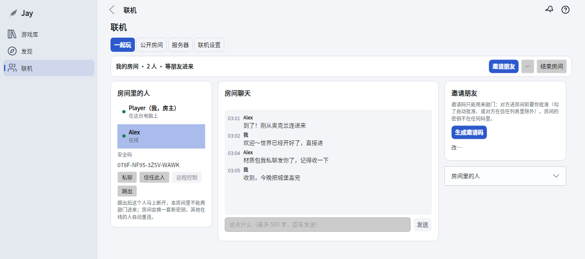
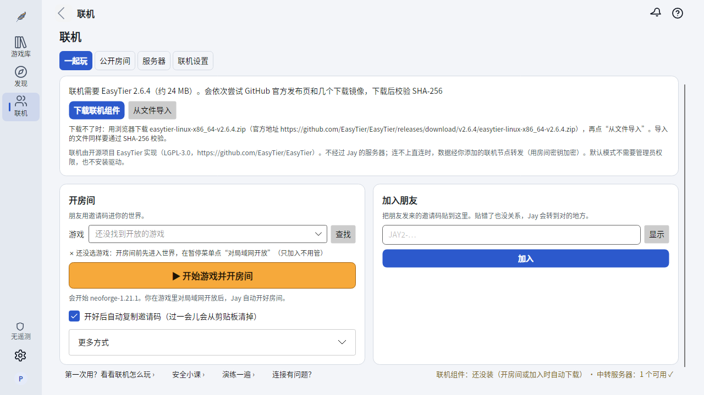
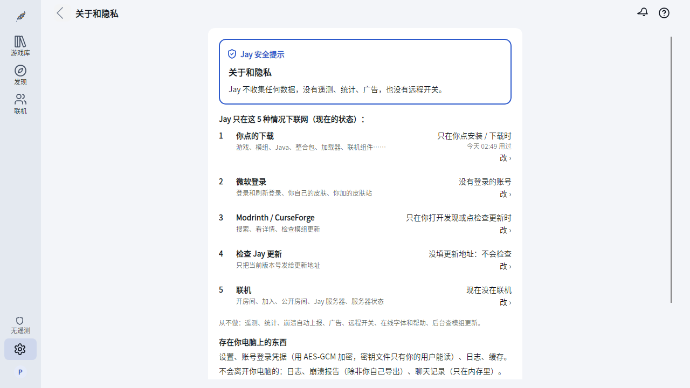
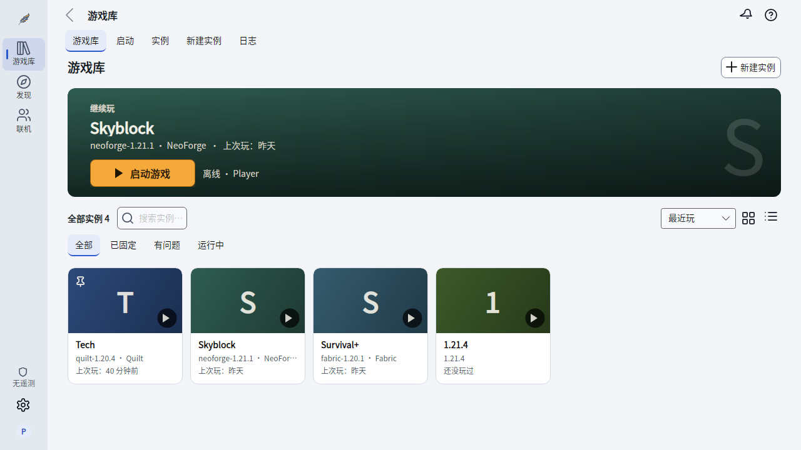

<div align="center">


# Jay

### 你和朋友的私密空间：一起玩、聊天、传东西，还自带 Minecraft 启动器。

隔着国境也能一起玩 Minecraft 和任何局域网游戏，聊天和传文件端到端加密，<br>
远程帮朋友修电脑，或者借朋友的网络上网。开源，没有任何遥测。

[](https://github.com/warriorleavestar/jay-launcher/releases/latest)
[](https://github.com/warriorleavestar/jay-launcher/actions/workflows/build.yml)
[](LICENSE)

[](https://github.com/warriorleavestar/jay-launcher/releases/latest/download/Jay-win-x64.zip)
[](https://github.com/warriorleavestar/jay-launcher/releases/latest/download/Jay-osx-arm64.tar.gz)
[](https://github.com/warriorleavestar/jay-launcher/releases/latest/download/Jay-linux-x64.tar.gz)

[English](README.md) · **简体中文** · [下载](#下载) · [功能](#功能) · [隐私](#隐私) · [常见问题](#常见问题) · [参与贡献](CONTRIBUTING.zh-Hans.md)



</div>

<br>

<table>
<tr>
<td width="50%" valign="top">

### 🌏 朋友们，一个局域网

发一个邀请，朋友“敲门”，你点批准，不管住在哪都进了同一个虚拟局域网。Minecraft、别的局域网游戏和软件都能直接用。能直连就直连，实在不通才中转。

</td>
<td width="50%" valign="top">

### 💬 聊天和传文件，端到端加密

房间群聊、给某个朋友发私信、传文件，全都用每个人自己的钥匙端到端加密，中转节点什么也看不到。朋友电脑出问题？申请远程控制帮 TA 修，每次都要 TA 同意。

</td>
</tr>
<tr>
<td width="50%" valign="top">

### 🔒 隐私是默认的

邀请码一次性、会过期，泄露了也没用。没有你批准谁也进不来，踢人会顺手换掉房间钥匙。没有遥测、没有设备识别码、没有远程开关，中间也没有 Jay 的服务器。

</td>
<td width="50%" valign="top">

### 🎮 完整的 Minecraft 启动器

Fabric、Quilt、Forge、NeoForge、OptiFine 一键安装，内置 Modrinth 和 CurseForge，整合包导入导出，崩溃分析直接告诉你是哪个模组的锅。

</td>
</tr>
</table>

> [!NOTE]
> 本项目在 v0.7.0 之前叫 **Amber**，旧账号和设置可以直接沿用。一起联机的人都要用 v0.7.0 或更新的版本。
> 标了 *实验* 的功能已通过自动测试，但还没在真实环境里完整验证过，遇到问题欢迎[反馈](https://github.com/warriorleavestar/jay-launcher/issues/new/choose)。

## 下载

到[最新版本](https://github.com/warriorleavestar/jay-launcher/releases/latest)下载与你的电脑对应的文件，解压就能用。不用另装任何东西：.NET 已经打包在里面，Jay 会为每个游戏版本找到或下载合适的 Java。

| 系统 | 文件 | 状态 |
|---|---|---|
| **Windows 10+** x64 | [`Jay-win-x64.zip`](https://github.com/warriorleavestar/jay-launcher/releases/latest/download/Jay-win-x64.zip) | ✅ 稳定 |
| **macOS** Apple 芯片 | [`Jay-osx-arm64.tar.gz`](https://github.com/warriorleavestar/jay-launcher/releases/latest/download/Jay-osx-arm64.tar.gz) | ✅ 已真机测试 |
| **macOS** Intel | [`Jay-osx-x64.tar.gz`](https://github.com/warriorleavestar/jay-launcher/releases/latest/download/Jay-osx-x64.tar.gz) | 🧪 实验 |
| **Linux** x64 | [`Jay-linux-x64.tar.gz`](https://github.com/warriorleavestar/jay-launcher/releases/latest/download/Jay-linux-x64.tar.gz) | 🧪 实验 |
| **Linux** ARM64 | [`Jay-linux-arm64.tar.gz`](https://github.com/warriorleavestar/jay-launcher/releases/latest/download/Jay-linux-arm64.tar.gz) | 🧪 实验（需自备 Java） |
| **Android** 伴侣 | [`Jay-android-experimental.apk`](https://github.com/warriorleavestar/jay-launcher/releases/download/android-preview/Jay-android-experimental.apk) | 🧪 实验，见 [docs/android.md](docs/android.md) |
| **Jay 服务器** | `JayServer-<平台>.zip` / `.tar.gz` | 🧪 实验，见 [server/README.md](server/README.md) |

<details>
<summary><b>Windows 说明</b></summary>

`Jay-win-x64.zip` 里是一个自带运行时的单文件 `Jay.exe`（ReadyToRun），解压就能运行。Native AOT 包暂时停发，因为它在 GitHub 的构建机上会耗尽内存或超时。v0.5.9 及更早的版本使用 `Amber-` 前缀和 `Amber.exe`。

目前 Windows 版还没有代码签名，第一次运行时 SmartScreen 可能会拦，见[常见问题](#常见问题)。
</details>

<details>
<summary><b>macOS 说明</b></summary>

解压后在终端里运行 `./Jay`。macOS 版暂时没有签名：如果第一次打开被 Gatekeeper 拦下，到“系统设置 → 隐私与安全性”里允许。完整局域网和出口节点模式开启时会要一次管理员密码。
</details>

<details>
<summary><b>Linux 需要的系统组件</b></summary>

Jay 的窗口需要桌面会话（X11，或带 XWayland 的 Wayland）和下面这些库。桌面发行版一般自带；在精简系统、容器或 WSL 里，Jay 启动时会列出缺什么、该装哪个包。

| 用途 | Ubuntu/Debian | Fedora | Arch |
|---|---|---|---|
| 窗口（必需） | `libx11-6 libice6 libsm6` | `libX11 libICE libSM` | `libx11 libice libsm` |
| 输入、光标、多屏（建议） | `libxi6 libxcursor1 libxrandr2` | `libXi libXcursor libXrandr` | `libxi libxcursor libxrandr` |
| 字体（必需） | `libfontconfig1` | `fontconfig` | `fontconfig` |
| 区域数据（建议） | `libicu78`（按你的系统版本，例如 `libicu74`） | `libicu` | `icu` |
| 中日韩字体（建议） | `fonts-noto-cjk` | `google-noto-sans-cjk-fonts` | `noto-fonts-cjk` |

- 没有 ICU 时 Jay 会以兼容模式自动重启，界面语言仍跟随 `LANG`，日期和数字用中性格式。
- Linux 版内置思源黑体（Noto Sans SC），没有系统中日韩字体时窗口里的中文和日文也能正常显示。标题栏由系统绘制，这时 Jay 会把标题显示为“Jay”；装上 `fonts-noto-cjk` 就能显示本地化标题。
- 完整局域网模式需要 `pkexec`，使用出口节点还需要 `nftables`。
- WSL：Windows 11 的 WSLg 可以直接显示 Jay 窗口。Ubuntu 上一次装齐：`sudo apt install libx11-6 libice6 libsm6 libxi6 libxcursor1 libxrandr2 libfontconfig1 fonts-noto-cjk`。
</details>

## 功能

### 🌏 和朋友一起玩、聊天、分享



- **邀请和敲门。** 房主开房间（玩 Minecraft 先在游戏里“对局域网开放”）；朋友粘贴邀请码并敲门，房主在锁定的弹出卡片上批准之前，谁也进不来。
- **聊天和传文件。** 房间群聊、私信和传文件都用每个成员自己的钥匙端到端加密，中转节点什么也看不到。收到的文件只存进 下载/Jay，Jay 不会替你打开，是程序还会额外提醒。
- **先直连，最后才中转。** Jay 会依次尝试 IPv6、路由器端口映射（UPnP / NAT-PMP）和 IPv4 打洞（严格 NAT 下带端口预测）；人多时由连得上的成员转发，都不行才用中转节点。“检查我的网络”可以提前告诉你别人连你有多容易。
- **任何局域网游戏和软件。** 完整局域网模式给每人一个虚拟 IP 并转发局域网广播，别的局域网游戏、文件共享、自己搭的小工具在朋友之间都能用，就像坐在同一个房间。Windows、macOS、Linux 都支持。
- **借朋友的网络。** 双方都同意后，可以经朋友的电脑上网（出口节点，带防泄漏）。Windows 上还能通过电脑的移动热点把这条线路分享给手机（[怎么用](docs/hotspot-sharing.md)）。
- **远程帮忙。** 申请查看并控制朋友的屏幕帮 TA 解决问题。每次都要对方同意，控制期间屏幕有红框，按 Ctrl+Shift+F12 立刻停止。
- **公开房间**（实验）。浏览房间列表、申请加入，也可以给房间设密码。房间由房主签名，别人伪造不了也重放不了。
- **演练和排查。** 演练模式不联网，带你走一遍敲门流程；“连接有问题？”抽屉能跑完整测试矩阵，生成去掉了密钥的报告。
- **Jay 服务器**（实验）。在 VPS 或局域网电脑上开一个只有 Jay 能进的 Minecraft 服务器。玩家用一次性的 `JAYS1-` 邀请加入；陌生连接一个字节都收不到。

联机基于开源项目 [EasyTier](https://github.com/EasyTier/EasyTier)（LGPL-3.0），第一次使用联机时下载并校验。默认模式不需要管理员权限，也不安装驱动。

### 🔐 隐私与安全



- **泄露了也没用的码。** 邀请码一次性，默认 10 分钟过期，里面不含房间密钥。码在屏幕上打码显示，复制 60 秒后从剪贴板清掉，从不写进日志或报告。
- **每人一把钥匙。** 踢人会立刻断开、拉黑并给房间换新钥匙。成员之间在聊天里无法冒充彼此。
- **老老实实的联网清单。** “关于和隐私”页列出 Jay 可能联网的 5 类情况、现在哪些开着、去哪里关。
- **给孩子用模式、无痕模式和安全熔断**，适合共用电脑或小朋友的电脑。
- **锁定的安全界面。** 敲门请求、文件提醒等安全面板在任何主题下都长一个样，主题没法把它们伪装掉。

### 🧩 模组、整合包和加载器



- Fabric、Quilt、Forge（包括 1.5.2 及更早）、NeoForge 和 OptiFine 一键安装。
- 从 Modrinth 和 CurseForge 搜索安装模组、资源包、光影、数据包和整合包，自动带上前置。
- 导入 mrpack、CurseForge、MultiMC / Prism、HMCL、MCBBS 和 PCL 整合包；导出 mrpack 和 CurseForge。
- 兼容性检查读取每个模组声明的加载器、游戏版本和前置，标出不匹配的并一键找到对应版本。
- 通过 Sinytra Connector 和 Forgified Fabric API 在 Forge / NeoForge 上跑 Fabric 模组，自动安装。
- 模组烘焙（实验，默认关闭）：启动前用本地的通用加载器预处理模组并缓存结果，见 [jay-loader](https://github.com/warriorleavestar/jay-loader)。
- 作者禁止第三方分发的模组绝不偷偷下载，Jay 会给出官方页面让你手动下载。

<details>
<summary><b>更多：账号、游戏管理、崩溃分析、下载</b></summary>

**账号**
- 微软（设备码）、authlib-injector 和离线账号，支持多账号和皮肤预览。
- 从不保存密码。登录凭据在 Windows 上用 DPAPI 保护，在 macOS 和 Linux 上用每个用户自己的本地密钥加密。

**游戏管理**
- 每个实例单独设置 Java、内存、JVM 参数、窗口大小和启动前 / 退出后命令。
- 管理世界和世界备份、截图、资源包、光影和服务器列表。
- 可为每个版本单独存放存档、模组和配置；旧版本绝不写进你自己的 `.minecraft`。
- 删掉的模组、世界和实例先进“最近删除”，可以撤销。

**崩溃分析**
- 找出崩溃的可能原因，列出可疑模组，并提供一键修复（加内存、禁用模组、关光影）。
- “帮我修…”一半一半地关模组，找出导致崩溃的那一个。
- 导出错误报告前先给隐私预览，报告里没有电脑用户名。

**下载**
- 并行分块下载，支持断点续传和 SHA-1 校验。
- 官方源或 BMCLAPI 镜像，按时区自动选择，失败自动切换。
- 模组扫描很快：几百个模组的文件夹不到一秒读完。

**日常顺手**
- 命令面板（Ctrl+K）、每页 F1 帮助、拖放安装、深浅两色，以及可导入的主题包（[docs/themes.md](docs/themes.md)）。
- 简体中文、繁體中文、English 和日本語，外加几种好玩的语言。
</details>

> [!TIP]
> 本页截图里的新界面（游戏库、发现、联机）已经在 `main` 分支上，会随下一个版本发布。v0.7.0 仍是经典布局。

## 隐私

Jay 只有一个承诺：**只为你要做的事联网。**

- **没有遥测。** 不收集使用数据，不生成设备识别码。
- **没有远程控制。** 没有任何远程开关或云端配置能改变 Jay 的行为。
- **更新由你决定。** 默认不检查更新；填了更新地址才检查，而且只提示。
- **中间没有 Jay 的服务器。** 房间码在你的电脑上生成。联机只连联机页里列出的中转节点（内置的可以关掉，也可以加自己的）和房间里的其他玩家。

<details>
<summary><b>Jay 可能连接的所有服务</b></summary>

- 登录：微软和 Xbox 登录，以及你添加的皮肤站。
- 游戏：Mojang 游戏文件服务器、你选择的下载源、各加载器的下载地址（OptiFine 通过 BMCLAPI，authlib-injector 通过其官方地址或 BMCLAPI）。
- 模组：Modrinth 和 CurseForge，只在你浏览或安装时。
- 联机，只在你开房间或加入时：联机页里列出的中转节点、房间里的其他玩家、Jay 服务器邀请里写的那台服务器，以及 EasyTier 的 GitHub 发布页（仅首次）。
- 直连房间会向你设置的 STUN 服务器（默认 `stun.miwifi.com`、`stun.chat.bilibili.com`、`stun.cloudflare.com`，可改可清空）询问你的外部地址，它们不经过游戏数据；也可能请你的路由器临时映射一个端口，结束联机时删掉。
</details>

代码完全开源，欢迎自己查。完整的隐私政策和 Jay 对系统的改动见[代码签名与隐私政策](docs/code-signing-policy.md#隐私政策--privacy-policy)。

## Jay 家族

| 项目 | 是什么 |
|---|---|
| [**Jay 服务器**](server/README.md) | 只有拿到邀请的 Jay 玩家才能进的 Minecraft 服务器 |
| [**网络服务器框架**](docs/network-server-framework.md) | 搭你自己的公共网络：种子节点、房间目录、登录和管理接口 |
| [**中转节点脚本**](node/README.md) | Linux、Docker、Windows 一步搭好中转节点 |
| [**公共网络注册表**](networks/README.md) | 提交社区网络，让 Jay 显示为“已审核” |
| [**jay-loader**](https://github.com/warriorleavestar/jay-loader) | 模组烘焙背后的通用模组加载器 |

## 从源码构建

需要 [.NET 10 SDK](https://dotnet.microsoft.com/download)。Jay 使用 C# 和 [Avalonia](https://avaloniaui.net/) 编写。

```shell
git clone https://github.com/warriorleavestar/jay-launcher.git
cd jay-launcher/src
dotnet build
dotnet test Amber.Core.Tests
dotnet run --project Amber.App
```

<details>
<summary><b>打包、命令行版和移动端实验</b></summary>

打包单文件版本（RID 可换成 `win-x64`、`osx-arm64`、`osx-x64`、`linux-x64` 或 `linux-arm64`）：

```shell
dotnet publish Amber.App -c Release -r osx-arm64 --self-contained -p:PublishSingleFile=true -p:IncludeNativeLibrariesForSelfExtract=true -p:PublishReadyToRun=true -p:DebugType=none -o ../publish
```

还有一个命令行版本，例如 `dotnet run --project Amber.Cli -- list-remote`。

[Android](docs/android.md) 和 [iOS](docs/ios.md) 实验版提供 Jay 服务器登记和本机网关。Android 版能让网关常驻，并打开另行安装的 FCL 来运行 Minecraft（Jay 不内置 FCL）；iOS 仍需要另外兼容的客户端。

第一次看代码？从 [docs/CODEMAP.md](docs/CODEMAP.md) 和 [参与贡献](CONTRIBUTING.zh-Hans.md) 开始。
</details>

### 配置

所有功能开箱即用。下面两项可选：

| 项目 | 在哪里 | 环境变量 | 说明 |
|---|---|---|---|
| 微软 Client ID | 账号 | `AMBER_MS_CLIENT_ID` | 留空使用内置默认值 |
| CurseForge API Key | 设置 | `AMBER_CF_KEY` | 到 [console.curseforge.com](https://console.curseforge.com) 免费申请。没有时不能用 CurseForge，其他功能不受影响 |

设置保存在系统应用数据目录的 `Amber/settings.json`（`%APPDATA%\Amber`、`~/Library/Application Support/Amber` 或 `~/.config/Amber`）。

## 常见问题

<details>
<summary><b>Windows 提示“已保护你的电脑”怎么办？</b></summary>

目前 Windows 版还没有代码签名，SmartScreen 可能会拦截。确认文件是从本项目的 Releases 下载的，点“更多信息”→“仍要运行”即可。签名生效后版本说明里会写明，见[代码签名政策](docs/code-signing-policy.md)。
</details>

<details>
<summary><b>Jay 只能玩 Minecraft 吗？</b></summary>

不是。Jay 从 Minecraft 起步，但一个 Jay 房间就是朋友之间的私密网络：完整局域网模式能跑任何局域网游戏和软件，聊天、传文件、远程帮忙和出口节点不玩游戏时也能用。
</details>

<details>
<summary><b>朋友也要装 Jay 吗？</b></summary>

要。房间、聊天和传文件都在 Jay 之间进行，房间里每个人都要用 v0.7.0 或更新的版本。Jay 服务器也按设计只让 Jay 进入。
</details>

<details>
<summary><b>可以用我现有的 <code>.minecraft</code> 文件夹吗？</b></summary>

可以。在设置里把游戏目录指向它，或者把它加进游戏库。
</details>

<details>
<summary><b>微软账号登录失败怎么办？</b></summary>

先看提示里的错误信息，并确认这个账号已经拥有 Minecraft。也可以换成你自己的 Azure 应用：注册一个允许个人账号、开启设备码流程、并且有 Minecraft API 访问权限的公共客户端应用，再把 Client ID 填到账号页。
</details>

<details>
<summary><b>为什么搜不到 CurseForge 的内容？</b></summary>

CurseForge 的接口需要 API Key，见上面的[配置](#配置)。Modrinth 不需要。
</details>

<details>
<summary><b>下载很慢怎么办？</b></summary>

在设置里切换下载源，试试官方源或 BMCLAPI 镜像。
</details>

<details>
<summary><b>下载包为什么这么大？</b></summary>

.NET 运行时和界面库都打包在里面，所以不用另外安装任何东西。
</details>

<details>
<summary><b>有哪些做不到的？</b></summary>

在 Fabric / Quilt 上运行 Forge 模组：目前没有可靠的兼容层，Jay 会直接说明。
</details>

## 许可证

Jay 以 [MIT 许可证](LICENSE)发布。

联机使用的 [EasyTier](https://github.com/EasyTier/EasyTier)（LGPL-3.0）是独立项目，Jay 不内置它，第一次使用联机时才下载。Linux 版内置的思源黑体（Noto Sans SC）使用 SIL Open Font License 1.1（[OFL.txt](src/Amber.App/Assets/Fonts/OFL.txt)）。

<div align="center">
<br>
<sub>Jay 不是 Minecraft 官方产品，与 Mojang 和 Microsoft 没有关联。<br>名字取自松鸦羽（Jayfeather），图标是一根羽毛。</sub>
</div>
